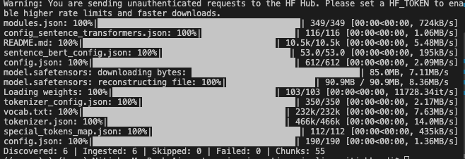
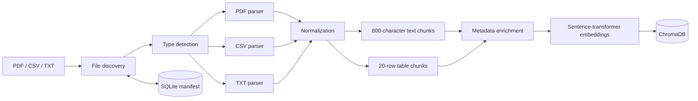

# Enterprise Multimodal Data Ingestion Pipeline for RAG

A small, inspectable Python project that demonstrates how heterogeneous enterprise files become retrieval-ready vectors.

The current MVP ingests **PDF, CSV, and TXT** sources through a complete pipeline: discovery, parsing, normalization, chunking, metadata enrichment, embedding generation, vector storage, and ingestion tracking. It deliberately focuses on the ingestion side of Retrieval-Augmented Generation rather than hiding the workflow behind a framework.

> **Learning goal:** understand what happens before a RAG system can retrieve useful context.

## Successful ingestion run

<p align="center">
  
</p>

The first run downloads the `all-MiniLM-L6-v2` embedding model. The final line confirms that six source files were processed successfully and stored as 55 chunks:

```text
Discovered: 6 | Ingested: 6 | Skipped: 0 | Failed: 0 | Chunks: 55
```

## Why ingestion matters

An LLM cannot search a folder directly. Before retrieval can happen, every source must be converted into consistently sized, traceable units:

1. **Discover** candidate files.
2. **Detect** their type and choose the correct parser.
3. **Parse** source-specific content without discarding useful structure.
4. **Normalize** inconsistent whitespace, missing values, and headers.
5. **Chunk** content into units small enough to retrieve accurately.
6. **Enrich** each chunk with source and location metadata.
7. **Embed** chunks as numerical vectors.
8. **Store** vectors for similarity search.
9. **Track** ingestion outcomes so completed files are not duplicated.

## Architecture



SQLite and ChromaDB solve different problems:

- **ChromaDB** stores chunk text, metadata, and embedding vectors for future retrieval.
- **SQLite** records file-level ingestion status, chunk counts, failures, and timestamps.

## Format-specific behavior

| Format | Parser output | Chunking strategy | Location metadata |
|---|---|---|---|
| PDF | One string per page | 800 characters, 100-character overlap | Page number and chunk index |
| TXT | One text string | 800 characters, 100-character overlap | Chunk index |
| CSV | pandas `DataFrame` | 20 rows per chunk, headers repeated | Start row, end row, and chunk index |

Page boundaries are retained for PDFs. CSV headers are repeated because an isolated table chunk is difficult to interpret without its column names.

Every stored chunk receives metadata similar to:

```json
{
  "source_path": "pdf/refund_policy.pdf",
  "file_name": "refund_policy.pdf",
  "file_type": "pdf",
  "page_number": 1,
  "chunk_index": 0
}
```

Chunk IDs are deterministic UUIDs derived from their source and location. Reprocessing the same location therefore updates the Chroma record instead of creating another ID.

## Project structure

```text
enterprise-ingestion-pipeline/
├── data/
│   ├── pdf/                    # PDF input files
│   ├── tables/                 # CSV input files
│   └── text/                   # TXT input files
├── parsers/
│   ├── pdf_parser.py
│   ├── table_parser.py
│   └── text_parser.py
├── chunkers/
│   ├── table_chunker.py
│   └── text_chunker.py
├── models/
│   └── document.py             # Common chunk representation
├── pipeline/
│   ├── discovery.py
│   ├── router.py
│   ├── normalization.py
│   ├── metadata.py
│   ├── embeddings.py
│   └── ingestion.py            # End-to-end orchestration
├── storage/
│   ├── manifest.py             # SQLite ingestion state
│   └── vector_store.py         # Persistent ChromaDB adapter
├── tests/
│   └── test_pipeline.py
├── main.py
└── requirements.txt
```

## Quick start

Python 3.12 is recommended.

```bash
git clone https://github.com/Nitishnaidu368/enterprise-ingestion-pipeline.git
cd enterprise-ingestion-pipeline

python3.12 -m venv .venv
source .venv/bin/activate
python -m pip install -r requirements.txt
```

Place files in their matching input folders:

```text
data/pdf/       -> .pdf
data/tables/    -> .csv
data/text/      -> .txt
```

Run the pipeline:

```bash
python main.py
```

Runtime state is written under `.state/`:

```text
.state/
├── manifest.db    # SQLite ingestion records
└── chroma/        # Persistent vector collection
```

On a second run, paths already marked `completed` are skipped:

```text
Discovered: 6 | Ingested: 0 | Skipped: 6 | Failed: 0 | Chunks: 0
```

To deliberately rebuild the MVP state, move it aside and run again:

```bash
mv .state .state.backup
python main.py
```

## Inspect the ingestion manifest

The manifest makes pipeline behavior auditable without opening ChromaDB:

```bash
sqlite3 .state/manifest.db \
  "SELECT source_path, status, chunk_count, updated_at FROM ingestions;"
```

A failed file is recorded with `status = 'failed'` and its error message. Successful files are marked `completed` only after their vectors have been written.

## Run the tests

The test suite uses Python's standard-library `unittest`; no additional test framework is required.

```bash
python -m unittest discover -s tests -v
```

It checks:

- Character overlap at text chunk boundaries
- Header repetition and row ranges for CSV chunks
- End-to-end ingestion into temporary ChromaDB and SQLite stores
- Manifest-based skipping on a repeated run

The embedding step is replaced with a deterministic fake during tests, so the suite runs offline and does not download a model.

## Technology choices

| Component | Choice | Reason |
|---|---|---|
| PDF extraction | `pypdf` | Lightweight extraction for text-based PDFs |
| Table parsing | `pandas` | Reliable CSV parsing and row slicing |
| Embeddings | `sentence-transformers` | Local embeddings without a hosted API |
| Vector database | `ChromaDB` | Simple persistent vector storage for an MVP |
| Ingestion manifest | SQLite | Durable, queryable state with no server |

## Current limits

This is a deliberately readable MVP, not a production ingestion service:

- File type detection currently trusts the extension.
- Scanned PDFs require OCR and are not yet supported.
- TXT and CSV inputs must be UTF-8; CSV files must have comma-delimited headers.
- Fixed character windows can split sentences or words.
- The manifest identifies files by path, not content checksum. A changed file at a completed path is skipped.
- Embeddings are generated per file rather than through a distributed batch system.
- ChromaDB and SQLite are local single-machine stores.

## Enterprise roadmap

- Excel and image ingestion
- MIME and file-signature validation
- OCR and layout-aware PDF extraction
- Token-aware, structural, and semantic chunking
- SHA-256 checksums and incremental ingestion
- Document versioning and stale-chunk deletion
- Metadata filtering and access-control metadata
- Batch processing, concurrency, retries, and dead-letter handling
- Structured logging, tracing, and ingestion metrics
- Model/version tracking and controlled re-embedding

The core lesson is that reliable RAG begins before retrieval: source structure, chunk boundaries, metadata quality, idempotency, and failure visibility determine what the retriever can ultimately find.
